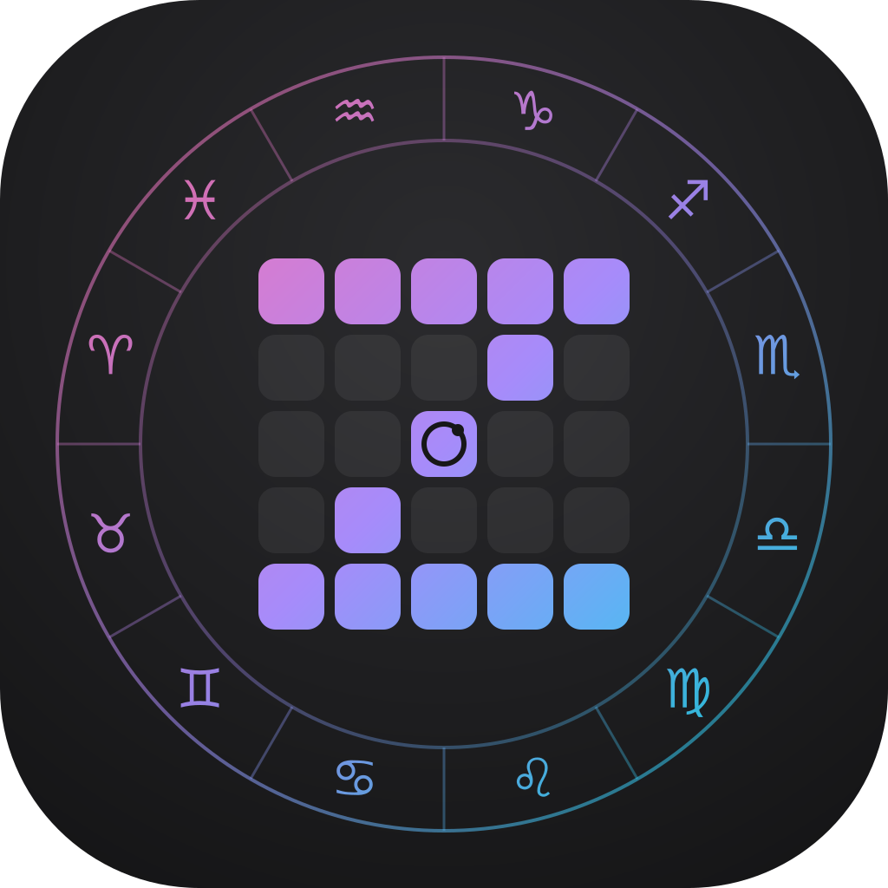

# Zodiann Specification: Zodiac Wheel and Gann Square of Nine

## App icon

The Zodiann app icon is a five-by-five Square of Nine grid whose lit cells trace a Z (the top row, the diagonal through a centre cell holding a small dial, and the bottom row) inside a ring of the twelve zodiac glyphs, all in one pink, violet and cyan gradient, on a near-black rounded square. It joins the app's two instruments, the zodiac wheel and the Square of Nine, in one mark. It is also the app's logo. Inside the app it appears without its tile: as is on the dark theme, and on the light theme with slightly deepened colours and dark empty cells. The design reference (`design-reference/zodiann/MASTER.md`) defines the in-app versions and sizes.



## Overview and goals

The app combines two tools for analyzing time cycles: a zodiac wheel with real astronomical planet positions, and the Gann Square of Nine, where every cell is a number, a day, or a 4-hour block. Both tools live in one app with a side navigation drawer, and are built for Hebrew (right to left) and English (left to right).

**Who it is for.** Analysts who combine astrology with Gann time cycles in their work and want a fast, accurate tool that is comfortable to use on a phone.

### Product goals

- **Accuracy:** planet positions are computed astronomically, not taken from approximation tables.
- **Exploration:** the user can rotate the wheel, move time, and see when each planet crosses each degree within a range of up to 10 years.
- **Fidelity to Gann's method:** the spiral layout, the angles and the highlights are defined explicitly, documented, and covered by automated tests.
- **Export:** every square and every crossing list exports to a well-organized Excel file.
- **Full Hebrew and English support, including RTL:** an interface adapted to phone and tablet, with light and dark themes.

### Success criteria (measurable targets)

- Deviation of a planet position from a recognized reference source: up to one arcsecond (against Swiss Ephemeris and JPL Horizons).
- Computing the degree-crossing table for one planet over one year: under two seconds on a mid-range phone.
- Every Gann rule in this document is covered by at least one automated test.

**What the app is not.** It does not write astrological interpretation, does not give buy or sell instructions, and does not compute a full birth chart in the first version.

## Users and use cases

The main user is a Hebrew- or English-speaking analyst who opens the app mostly on a phone, and sometimes on a tablet or computer, to check time cycles against specific dates. The app does not require registration, and all of its settings are stored on the device.

## Development status and scope

Development has not started: this whole document is a plan, and no part of it exists as a product. The product will be built from scratch in Flutter, and every description in this document is a requirement for future development.

### In scope for the professional product

| ID | Use case | Screen | Stage |
|---|---|---|---|
| UC1 | See where each planet is right now and in which sign and degree | Zodiac wheel | Planned |
| UC2 | Find when a planet crosses a specific degree, for example 0° Taurus, within a date range | Zodiac wheel, degree table | Planned |
| UC3 | See the state of the planets on a historical or future date the user enters | Zodiac wheel | Planned |
| UC4 | Build a day square from an anchor date and see where today sits relative to the highlighted angles | Square of Nine, dates mode | Planned |
| UC5 | Build a square in 4-hour steps from an anchor date and time | Square of Nine, date and time mode | Planned |
| UC6 | Tap a cell and get its number, its square, its angle, its ring and highlight information | Square of Nine | Planned |
| UC7 | Export the square to Excel and keep working with it elsewhere | Square of Nine | Planned |
| UC8 | Rotate outer rings around the square and see how the angles in the cells update | Square of Nine | Planned |
| UC9 | Show planet positions on the square and see which cells they hit | Both screens together | Planned |
| UC10 | Save squares and settings by name and return to them | Whole app | Planned |

- Two screens in one app: the zodiac wheel and the Gann Square of Nine, with a side navigation drawer.
- Geocentric astronomical computation in the tropical zodiac, for ten bodies and the mean lunar node.
- Saving settings and saved squares for the user, locally on the device only.
- Export to Excel, and in later stages export to PDF and to an image.
- An additional layer of angles and outer rings around the square (rotating rings), and showing planets on the square.

### Out of scope for the first version

- Astrological interpretation text or trading recommendations.
- A birth chart with ascendant and houses: they depend on birth place and time, and are discussed in the planning section.
- The sidereal zodiac, and the true node as the default (it is included as a setting option).
- A server, user accounts and sync between devices (not in the current plan).

### Planning constraints that must be addressed

- Automated tests for the computation core and comparison against reference data are mandatory (see the testing strategy).
- The app works without internet and does not load libraries from the network.
- Computing the degree table does not run on the UI process (see ARCH-1).
- A large square (61×61) is drawn on one canvas and not as 3,721 separate elements (see ARCH-5).
- Aspect orbs are configurable in settings.
- The time zone is the device's, and 4-hour steps are measured in absolute time, so across a daylight-saving change the displayed hour jumps by one hour. A decision is needed on whether this is the desired behavior.

## Navigation and app structure

The app is built from a single shell and one active screen at any moment, and moving between screens is done from a side drawer that opens from a hamburger button in the top corner (the right corner in Hebrew, the left corner in English).

### Navigation requirements

- **NAV-1.** A sticky top bar with a hamburger button at the start side (right in Hebrew, left in English), and next to it the title and subtitle of the active screen. The button is at least 46×46 logical pixels.
- **NAV-2.** The button opens a drawer from the start side, up to 320 logical pixels wide or 86% of the screen, with a dimmed backdrop. It closes by tapping the backdrop, the close button, swiping aside, or the Android back button.
- **NAV-3.** Every drawer item shows a name and a short description. The active item is marked with the accent color and the accessibility state "selected".
- **NAV-4.** One screen is shown at any moment. Switching screens scrolls to the top and stops any running time playback on the wheel.
- **NAV-5.** The active screen is kept in navigation (go_router), and a deep link to the square opens it directly. An unknown route shows the wheel. The hash values in the table are route identifiers and not web addresses.
- **NAV-6.** Accessibility: on open, focus moves to the active item, and on close it returns to the hamburger button. The button has an expanded or collapsed accessibility state and an accessibility label.
- **NAV-7.** On a phone the drawer extends to the edge and hides the content behind it. On a large screen it remains an openable drawer and is not permanent, with the same pattern and the same behavior.

| Screen | Route | Main content | Stage |
|---|---|---|---|
| Zodiac wheel | `#wheel` (default) | The wheel, the positions table, the degree table | Planned |
| Gann Square of Nine | `#square` | Controls, the square, cell details, export | Planned |
| Saved squares | `#saved` | List of saved squares and settings | Planned |
| Settings | `#settings` | Time zone, aspect orbs, theme, default size | Planned |
| About and sources | `#about` | Version, computation sources, explanation of method settings | Planned |

## Zodiac wheel screen

The wheel shows the tropical geocentric position of ten bodies and the lunar node at any given moment, and lets the user rotate it, move time and search for degree crossings.

### Wheel structure

- **WH-1.** An outer ring of 12 signs, each a 30° arc, in order from Aries to Pisces. Each sign gets a glyph, a color by element (fire, earth, air, water) and a subtle background tint in the same color.
- **WH-2.** A degree scale: a tick for every degree, a longer tick every 5° and an even longer one every 10°, and the degree number within the sign (10 and 20) every ten degrees.
- **WH-3.** Each body is shown with its own fixed glyph and color, with the whole degree number within the sign. A line connects it to its exact position on the scale, and a dot on the inner circle marks that same position.
- **WH-4.** Bodies closer than 11° to each other are pushed apart in the display only. The true position stays marked on the scale and on the inner circle.
- **WH-5.** A body moving backward is marked with ℞ next to the degree. The lunar node has no such mark on the wheel.
- **WH-6.** Between every pair of bodies (excluding the node) a line is drawn on the inner circle when the angle between them is within the aspect orb: conjunction 0° ±8°, sextile 60° ±4°, square 90° ±6°, trine 120° ±6°, opposition 180° ±8°. Conjunction in amber, sextile and trine in turquoise, square and opposition in red.
- **WH-7.** A fixed pointer at the top of the wheel. Below the wheel are shown the sign, the degree and the minute under the pointer, and the bodies within 3° of it.

### Interaction

- **WH-8.** Dragging with a finger rotates the wheel around its center, following the angle of the touch point.
- **WH-9.** Two drag modes. In "rotate wheel" mode only the display rotates. In "change date" mode a counterclockwise drag advances time, one degree per day.
- **WH-10.** On a device with an external keyboard, when the wheel is focused, the left and right arrows move one degree, and with Shift ten degrees (and with a screen reader, equivalent accessibility actions move one degree), according to the selected drag mode.
- **WH-11.** Time controls: a date and time field, a "Now" button, back and forward buttons with a selectable step size (hour, day, week, 30 days), and automatic playback at one step every 110 milliseconds.
- **WH-12.** Playback stops when moving to another screen.
- **WH-13.** Tapping a row in the positions table rotates the wheel until the body is under the pointer, with an animation of about 450 milliseconds. A user who enabled reduced motion in the system gets a jump without animation.
- **WH-14.** On open, the time is the current moment and the wheel is rotated so that the Sun is under the pointer.

### Positions table

- **WH-15.** A row for each body: glyph and name, sign, degree and minute (for example 14°32'), and direction: direct, ℞ retrograde, or ℞ mean for the node. The minute is rounded down.

### Degree table

- **WH-16.** Filters: planet (one, or all except the Moon), a date range of up to 3,660 days, sign, and degree within the sign (0 to 29). The default is all planets, from today to one year ahead.
- **WH-17.** Each row shows local date and time, body, sign, degree and a retrograde mark. Rows are sorted by time, up to 2,500 are shown, and the counter shows the total.
- **WH-18.** A retrograde body can cross the same degree several times. Each crossing is a separate row, and the retrograde is marked.
- **WH-19.** Tapping a row sets the date and rotates the wheel so that the degree is under the pointer. The screen scrolls to the wheel.
- **WH-20.** The Moon is not included in the "all" selection, because it moves about 13 degrees a day. It can be selected separately.

### Planned extensions to the wheel

- User-defined aspect orbs, and showing the list of active aspects in the table.
- The true node as an option next to the mean node.
- Additional bodies, such as Chiron and Lilith. They are not in the scope of the first version, and adding them requires checking the ephemeris source.
- The sidereal zodiac with a choice of ayanamsa.
- Ascendant and houses, once there is input of birth place and time.

## Gann Square of Nine screen

The square arranges numbers in a spiral around the center, and every cell gets an angle that determines whether it is highlighted in blue, yellow or gray. In the date modes every number becomes a day or a 4-hour block.

### Modes and anchor

- **SQ-1.** Three modes: numbers, dates, and date and time in 4-hour steps. Switching mode preserves the size and the selected cell, if it is still in the square.
- **SQ-2.** Numbers mode: cell n shows n, and the center holds the number 1.
- **SQ-3.** Dates mode: cell n is the anchor date plus n−1 days, and the center is the anchor itself. The format in the cell is day.month.year with two digits and no leading zero, for example `4.1.22`.
- **SQ-4.** Date and time mode: cell n is the anchor moment plus 4×(n−1) hours. The cell shows the date, and below it the time in HH:MM format.
- **SQ-5.** An anchor field according to the mode: a date, or a date and time to the minute. An "Anchor to today" or "Anchor to now" button sets the current moment. The default is today at 00:00.
- **SQ-6.** A "Show up to today" button (in hour mode: "up to now") computes the cell number of today, sets a custom size that contains it, selects the cell and scrolls to it. If the anchor is after today, a message is shown instead. If today is further than 3,721 cells away, the size stops at the maximum and a message is shown.
- **SQ-7.** In the date modes, the cell of today (or of the current moment) is marked with a turquoise border and a "Today" tag in the cell details. When the center is also today, the border is double.

### Layout and size

- **SQ-8.** 1 in the center, 2 to its left, and the spiral continues clockwise: left, up, right, down. This is the user's decision, and it appears in the open questions section for verification and future change.
- **SQ-9.** Ring k contains 8k cells, and the side of the square up to it is 2k+1. The last cell in ring k is (2k+1)², for example 9 in ring 1 and 81 in ring 4.
- **SQ-10.** Square size by choice: 9×9, 13×13, 17×17, 21×21, or custom. For custom, the user enters a number of cells between 9 and 3,721, and the number is rounded up to a full square with an odd side (up to 61×61). The actual number of cells is shown below the controls.

### Angles and highlights

- **SQ-11.** The angle of a cell in ring k is 45°·i/k, where i is the number of steps of the cell from the axis where the number 2 sits (left of the center), clockwise, in the range 0 to 8k−1. The center has no angle.
- **SQ-12.** Blue: 0°, 90°, 180° and 270°. The angle 360° is the same point as 0°.
- **SQ-13.** Yellow: the diagonals 45°, 135°, 225° and 315°.
- **SQ-14.** Gray: the other multiples of 22.5° (360÷16), that is 22.5°, 67.5°, 112.5° and so on.
- **SQ-15.** Priority order: blue, then yellow, then gray. A cell that meets none of the conditions is not highlighted. The center is marked with an amber border.

The number of highlighted cells in each ring is fixed by the parity of k. In a 9×9 square (rings 1 to 4) there are 16 blue cells, 16 yellow and 16 gray.

| Ring k | Cells in ring | Blue | Yellow | Gray |
|---|---|---|---|---|
| Odd (1, 3, 5...) | 8k | 4 | 4 | 0 |
| Even (2, 4, 6...) | 8k | 4 | 4 | 8 |

### Cell details

- **SQ-16.** Tapping a cell selects it, marks it with a white border and shows details in a panel. On a wide screen the panel floats next to the square, and on a phone it appears above the square.
- **SQ-17.** The details: the cell number and the highlight tag; the number squared (for example 49² = 2,401); the square root to four digits after the point; the ring and the number of cells in it; the angle; the direction (axis, diagonal, or "between the axes and the diagonals"); the offset from the center (for example "3 left, 2 up"); whether the cell is a multiple of 45° and of 22.5°; and the highlight line in words.
- **SQ-18.** In the date modes the details also show the full date (weekday, day, month name, year, and in hour mode also the time) and the distance from the anchor, in days or hours.
- **SQ-19.** Selection with an external keyboard: arrows move the selection one cell in each direction on the board, up to the edge.

### Display

- **SQ-20.** Cell size fits the available width: between 30 and 56 pixels in numbers mode, 40 to 64 in dates, and 46 to 72 in date and time. When the square is wider than the screen it scrolls horizontally inside its own container, without scrolling the page itself.
- **SQ-21.** The square is always displayed left to right, even in the Hebrew interface, so that the geometric layout is preserved.
- **SQ-22.** A legend below the square explains the colors and how the angle is measured.

### Planned extensions to the square

- Outer rings rotating around the square, with a scale from 0 to 360 degrees. Rotating a ring adds an offset to the angle of all cells, and the highlights and the angle in the cell details update accordingly. This is an interpretation of the plan, and it needs approval.
- Showing planet positions on the square and moving between the two screens.
- Setting additional highlighted angles chosen by the user, and a color for each group.
- Entering a number or a date and jumping to the matching cell.
- Defining the start point and spiral direction as a setting (left, right, up, down; clockwise or counterclockwise).

## Excel export and other formats

The "Export to Excel" button on the square screen creates an organized xlsx file from the square currently shown, with three sheets. The file reflects the mode, size and anchor the user chose at that moment.

### Sheets in the file

- **EX-1.** Sheet "Square". The square in a layout identical to the screen, with the same highlight colors (blue, yellow, gray, and white for the center), an amber border for the center and a turquoise border for today. Above the square is a header with the mode, the size and the anchor, and below it a legend. In the date modes the cells hold real date values in the format d.m.yy, and in date and time mode, text on two lines.
- **EX-2.** Sheet "Cell list". A row for each cell with the columns number, square, square root, ring, angle, direction, highlight, and the position of the cell in the first sheet. In the date modes, date and day columns are added, and in hour mode also a time column. The square and the root are live Excel formulas. The sheet has filtering and sorting, a frozen header row, and a right-to-left direction in the Hebrew version of the file.
- **EX-3.** Sheet "Details". The mode, size, anchor date, the cell of today and its position in the first sheet, the spiral direction, how the angle is measured, and the creation date.

### Requirements

- **EX-4.** The file name includes the mode and the size, for example `gann-square-of-nine_dates_43x43.xlsx`.
- **EX-5.** Exporting a square of the maximum size (61×61, 3,721 cells) completes within three seconds on a mid-range device, and the interface does not freeze during that time.
- **EX-6.** During export the button is disabled and a status message is shown: preparing, saved, canceled, or an error with an explanation.
- **EX-7.** The file is written to temporary storage in the app and opened in the system share sheet (save, Excel, mail, and more). Closing the sheet without choosing is not an error.

### Export with live formulas (a new requirement that overrides the sheet descriptions wherever they conflict)

The generated file is not a fixed picture of the square but a sheet that computes itself. The center cell is the anchor and is the only input of the sheet: the user changes it to a new date or number, and all other cells in the square, in the cell list and in the details are recalculated and shown according to Gann's square rules. This section overrides the sheet descriptions above wherever it contradicts them.

#### Calculation rules in the file

- **EX-8.** The center cell in the "Square" sheet is an input cell with a defined name (`Anchor`), a format that distinguishes it from the other cells, a "Change here" note and input validation: a number in numbers mode, a date in dates mode, a date and time in date and time mode. A value of another type is rejected with a message.
- **EX-9.** Every other cell in the square is a formula that uses the anchor and the number of steps k of the cell from the center in the spiral (a constant for each cell, stored in the helper sheet). Numbers: anchor plus k. Dates: anchor plus k days. Date and time: anchor plus k times the step in hours divided by 24.
- **EX-10.** Moving the anchor updates all cells at once: the values, the colors, the "today" mark, the cell list and the details, with no macro and without any additional manual action.
- **EX-11.** The geometry of the spiral (the angle, the ring, the direction, the highlight type) is a property of the position in the square and not of the displayed value. Therefore it does not change when the anchor moves, and the values in the cells are counted from the new anchor onward. This is the definition of "recalculating according to the rules" in the sense the user asked for, and it is raised for approval in the open decisions section.
- **EX-12.** In date and time mode the step in hours is a separate parameter cell (default 4), and changing it updates everything.
- **EX-13.** The "today" mark is set by conditional formatting that compares the cell to the current date on the computer (by day in dates mode, by the 4-hour block in date and time mode). The mark moves with the anchor.
- **EX-14.** The cell list and the details hold the angle, the ring, the direction and the number squared in live formulas that point back to the cell in the square, and not fixed values.
- **EX-15.** On generation, the computed result (a cached value) is also written in every cell, so the file displays correctly in a preview and in apps that do not calculate. The file is flagged for recalculation on open.
- **EX-16.** Only basic functions that work in Excel, LibreOffice and Google Sheets (for example addition, multiplication, square root and modulo), without dynamic array functions or custom functions and without macros.

#### The formulas (in a form that can be copied into the implementation)

| Item | Formula |
|---|---|
| Cell value (numbers) | `=Anchor + k` |
| Cell value (dates) | `=Anchor + k` (Excel stores dates as a number of days, so adding advances a day) |
| Cell value (date and time) | `=Anchor + k * StepHours / 24` |
| Ring r | `=IF(k=0, 0, ROUNDUP((SQRT(k+1) - 1) / 2, 0))` |
| Index in ring i | `=IF(r=0, 0, MOD(k - (2*r-1)^2 - (r-1), 8*r))` |
| Angle | `=IF(r=0, 0, 45 * i / r)` |
| Blue | `=AND(r>0, MOD(i, 2*r) = 0)` |
| Yellow | `=AND(r>0, NOT(Blue), MOD(i, r) = 0)` |
| Gray | `=AND(r>0, NOT(Blue), NOT(Yellow), MOD(2*i, r) = 0)` |
| Today (dates) | `=INT(CellValue) = INT(NOW())` |
| Today (date and time) | `=AND(NOW() >= CellValue, NOW() < CellValue + StepHours / 24)` |

`Anchor` and `StepHours` are defined names in the file, k is a constant number in every cell, and the formulas for ring, index, angle and highlight type build them exactly as in the spiral rules in the calculation rules section. The colors in the square are set by conditional formatting that uses the same results, and the accuracy of the angle is verified by comparing whole-number indexes, with no decimal numbers.

#### One open decision for approval

When the anchor in numbers mode is changed to a different number (for example 100), the spiral stays the same spiral and the number 100 sits in the center, and every additional cell gets 100 continuously. The highlights do not move. This is the interpretation understood in this document for now. The alternative is to compute the angle from the displayed value (from the square root of the number), in which case the highlights would move with the anchor. The correct interpretation must be approved before development.

#### Limits that will remain in the file

- Changing the size of the square or the mode (numbers, dates, date and time) requires exporting again from the app.
- The file has no time zone. A daylight-saving jump in date and time mode is not modeled, so the file may show a different hour than the app on days when the clock jumps.
- An anchor date before the year 1900 is not supported in Excel.

### Other formats

| Format | Screen | Content | Stage |
|---|---|---|---|
| xlsx | Square of Nine | Three sheets as described above | Planned |
| xlsx or csv | Degree table on the wheel | The same columns as the table, all results and not only the first 2,500 | Planned |
| csv | Square of Nine | The cell list only | Planned |
| png or pdf | Square of Nine and zodiac wheel | An image of the screen as displayed, with a choice between the light and dark theme | Planned |
| ics | Degree crossings | A calendar event for each selected crossing | Idea |

## Calculation rules and formulas

All calculations will sit in a layer separate from the interface, in a few pure functions that can be tested independently: planet position, degree crossing, aspect, cell position in the spiral, and the date of a cell.

### Planet position

**Input:** a body and a moment (UTC). **Output:** tropical ecliptic longitude in degrees, in the range 0 to 360 (not including 360).

**Method:** a geocentric vector of the body with aberration correction, converted to longitude on the true ecliptic of date. This is the tropical zodiac.

It is forbidden to add an extra precession correction. Such a mistake shifts all positions by a few tenths of a degree. A regression test must catch it.

The lunar node is the mean ascending node: Ω = 125.04452 − 1934.136261·T degrees, where T is the number of Julian centuries since 2000-01-01 12:00 UTC. This is a linear approximation that deviates from the full formula by less than 0.01° over two hundred years around 2000.

**Retrograde:** a body is considered retrograde when the speed of its longitude is negative, according to the speed returned by the ephemeris source. For the node, retrograde is defined as constant, and the table shows mean ℞.

**Position format:** sign = ⌊l ÷ 30⌋, degree = ⌊l mod 30⌋, minute = ⌊(l mod 30 − degree)·60⌋.

### Degree crossings

**Definition:** a crossing is the moment when the longitude of a body equals a whole degree d, with d between 0 and 359.

The solver splits the search range into segments in which the speed does not change sign, and in each segment looks for the crossing moment with bisection or the Brent algorithm (see the astronomical accuracy section). A fixed time-step scan is not the primary method.

Every whole degree that lies between two points gets a time by linear estimate, and then it is refined up to three times: `t ← t − (l(t) − d) ÷ v`, where v is the instantaneous rate measured over one minute.

The retrograde mark is determined by the sign of the difference in the step.

The steps were chosen so that no body moves more than 0.7° in one step. A known risk: near a stationary point a body can cross a degree and return backward within one step, and the scan misses both crossings. Required: denser sampling when the instantaneous rate is close to zero.

Product limits: a range of up to 3,660 days, and up to 2,500 displayed rows.

### Aspects

| Aspect | Angle | Orb (±) | Color on the wheel |
|---|---|---|---|
| Conjunction | 0° | 8° | Amber |
| Sextile | 60° | 4° | Turquoise |
| Square | 90° | 6° | Red |
| Trine | 120° | 6° | Turquoise |
| Opposition | 180° | 8° | Red |

**Rule:** Δ = |wrap180(l₁ − l₂)|. An aspect exists when |Δ − angle| ≤ orb. For each pair the aspects are checked in the order of the table, and the first match decides.

The lunar node does not take part in aspects.

### Gann spiral

```
k = ceil((sqrt(n) - 1) / 2),   j = n - (2k-1)^2 - 1,
i = (j - (k-1)) mod 8k,        θ = 45° · i / k
```

n = 1 is the center, with no angle.

Position (x, y) relative to the center, with x to the right and y downward: from j, first compute (k, j−k+1) when j < 2k; (3k−1−j, k) when j < 4k; (−k, 5k−1−j) when j < 6k; otherwise (j−7k+1, −k). Finally flip both signs, (x, y) ← (−x, −y), so that 2 is to the left of 1 and the spiral runs clockwise.

i is the number of steps of the cell from the axis where 2 sits, clockwise, and θ is the discrete ring angle of the cell.

- **Blue:** `i mod 2k = 0`.
- **Yellow:** `i mod k = 0` and not blue.
- **Gray:** `2i mod k = 0` and not blue or yellow.

Square root and power, √n and n², are computed directly from the number.

In the literature on Gann it is also customary to measure a continuous angle from the square root of the number. The app currently uses the discrete ring angle. The decision between the two is in the open questions.

### Dates

**Dates mode:** `date(n) = anchor + (n−1)` calendar days. It is computed by building a local date (year, month, day + n−1), so that daylight saving does not shift the date.

**Hour mode:** `moment(n) = anchor + 4·(n−1)` hours in absolute time. When crossing a daylight-saving change, the displayed local hour jumps by one hour. The decision on whether to show local time, UTC or a chosen time zone is in the open questions.

The cell of today: in dates mode, the number of calendar days between the anchor and today, plus 1. In hour mode, the number of 4-hour blocks that passed from the anchor until now (rounded down), plus 1.

**Display format:** day.month.year with two digits and no leading zero. Time in HH:MM format.

## Astronomical accuracy

The goal is maximum accuracy: a body position within one arcsecond of the reference data, and a degree-crossing moment determined by an iterative computation to a defined threshold. This section overrides any place in the document that describes the computation method.

### Data sources, in order of priority

| Source | Role | Expected accuracy | Limitation |
|---|---|---|---|
| Swiss Ephemeris with JPL-based data files | Primary source | Sub-arcsecond within the range the files cover | License, size of the files, FFI binding |
| Swiss Ephemeris in built-in mode (Moshier) without files | Intermediate mode when the files are missing | Lower than the files mode | Not used as the default, and the user gets a message |
| astronomy-engine (C version, via FFI) | Backup with no data files, and an additional oracle for tests | On the order of an arcminute or better | Less accurate than the primary source, and the node is computed by formula |
| JPL Horizons | Reference data for tests only | The reference source | Requires a network, so it is not part of the app |

### Computation settings that must be fixed and documented

| Parameter | Value | Note |
|---|---|---|
| Viewpoint | Geocentric (from the center of the Earth) | A topocentric option, off by default. The main effect is on the Moon, up to about a degree |
| Position type | Apparent position: light time, aberration, light deflection and nutation | This is the position seen in the sky, and what astrology tools display |
| Reference frame | Ecliptic and equinox of date (tropical) | With no extra precession correction on top of the library |
| Ascending node | Mean by default, true as a setting option | The active type is shown clearly in the table and in the export. The difference between the types can reach about a degree and a half |
| Time | Input in local time is converted to UTC, and from there to terrestrial time using the difference called delta T | Delta T for the future is a forecast, so Moon accuracy drops for dates far in the future. The interface warns about this |
| Date range | According to the coverage of the data files that are packaged | Outside the range a clear message is shown instead of a wrong result |
| Retrograde | By the sign of the speed from the ephemeris | Not by the difference between two positions an hour apart |

### Exact degree-crossing solver

- **CRS-A1.** The longitude speed (degrees per day) comes directly from the ephemeris, and retrograde is a negative speed.
- **CRS-A2.** The search range is split into segments in which the speed does not change sign (separated at the stationary points). Each segment has at most one crossing, so a double crossing is not missed.
- **CRS-A3.** In each segment the search runs within a closed bracket with an algorithm whose convergence is guaranteed (bisection or Brent), down to a deviation of 0.01 arcseconds in longitude.
- **CRS-A4.** The stationary points (direction changes) are computed separately and stored, to explain double crossings and to test them.
- **CRS-A5.** The moment is displayed to the second. The degree of a body is the floor of the longitude, and the handling of the boundary between 359.9999 and 0 is documented in test T-CRS-3.

### Accuracy tests

- **ACC-1.** A reference set of at least 50 dates from 1900 to 2100, including dates near a retrograde and near the start of a year, for the ten bodies, stored as a JSON file from JPL Horizons data with the same settings. Allowed deviation for each body: one arcsecond. The node is tested separately against Swiss Ephemeris.
- **ACC-2.** The same set against the astronomy-engine backup (C version), with an allowed deviation of one arcminute, to detect a fault in the backup.
- **ACC-3.** A comparison against Astrolog with identical settings (geocentric, tropical, the same node type). A gap above one arcsecond must be explained.
- **ACC-4.** For each body, including during retrograde, a very small-step scan that runs in tests only is compared to the solver results: there is no missing or extra crossing.
- **ACC-5.** The regression test for the double precession correction (T-EPH-1) remains mandatory.

### Decisions and implications

| Topic | Status | Recommendation and implication |
|---|---|---|
| Running Swiss Ephemeris in Flutter | A C library. Dart runs C code directly via FFI, with no bridge and no WebAssembly. Binding and building for each platform require setup and testing on iOS and Android | A local Dart package that binds the C code via FFI (ffigen, with native assets or CMake). A spike in phase 1 proves that the binding works on both platforms |
| License | AGPL, or a paid professional license from Astrodienst | Clarify with the vendor before starting. This is not legal advice |
| Data files | Split by time periods | Choose which range to package in the app and measure the size, because the range supported in the interface depends on this decision |

## Data model and user settings

The model has four entities: user settings, saved square, highlight rule and crossing result. All data is stored locally on the device only, with no server, no account and no sync. A server is not part of the current plan.

| Entity | What it holds | Saved? |
|---|---|---|
| UserSettings | Theme, time zone, aspect orbs, visible bodies, node type (mean or true), ephemeris source, zodiac system, square defaults | Yes |
| SquareConfig | Saved square: name, mode, anchor, size, spiral direction and highlight rules | Yes |
| HighlightRule | A highlight rule: which angles, in which color and with what priority | Yes, inside the square |
| Crossing | A degree crossing: a moment in UTC, a body, an absolute degree and a retrograde mark | No, derived from the computation |

The structures below are a proposal for Dart classes (immutable data classes, with conversion from and to JSON, for local storage and export to a file). There is no server contract, because there is no server.

```dart
enum SquareMode { numbers, dates, datetime }
enum SpiralStart { left, right, up, down }
enum SpiralRotation { cw, ccw }

class SquareConfig {
  final String id;
  final String name;
  final SquareMode mode;
  final DateTime? anchor;      // with time zone offset; null in numbers mode
  final int stepHours;         // 4 in date and time mode
  final int size;              // odd, between 3 and 61
  final SpiralStart spiralStart;
  final SpiralRotation spiralRotation;
  final List<HighlightRule> highlights;
  final DateTime createdAt;
  final DateTime updatedAt;
}

sealed class HighlightMatch {}
class AnglesMatch extends HighlightMatch { final List<double> degrees; }
class MultipleOfMatch extends HighlightMatch { final double degrees; }

class HighlightRule {
  final String id;
  final String label;
  final HighlightMatch match;
  final String colorToken;     // a color token name, not a hex value
  final int priority;          // a lower number wins
}

enum Body { sun, moon, mercury, venus, mars, jupiter, saturn, uranus,
            neptune, pluto, node }

class Crossing {
  final DateTime timeUtc;
  final Body body;
  final int degree;            // 0 to 359, absolute
  final bool retrograde;
}
```

### Default highlight rules

| Rule | Match | Color | Priority |
|---|---|---|---|
| Axes | Angles 0, 90, 180, 270 | Blue | 1 |
| Diagonals | Angles 45, 135, 225, 315 | Yellow | 2 |
| Eighths | Multiples of 22.5 | Gray | 3 |

### Storage rules

- **DATA-1.** On-device storage: settings in shared_preferences, and saved squares in SQLite (via drift), with a schema version number and a migration when the structure changes.
- **DATA-2.** Settings, saved squares (up to 100) and the last state of each screen are saved. Computation results are not saved, because they can be recomputed.
- **DATA-3.** A backup of all data can be exported and imported as a single JSON file, with a version field.
- **DATA-4.** Anchor dates are saved with a time zone offset, so that a square opens with exactly the same dates even when traveling or across a daylight-saving change.
- **DATA-5.** The app does not collect personal information and does not send any data off the device. There are no accounts.
- **DATA-6.** Local storage only: all saved data (settings, saved squares, language and theme choice) is stored only on the device, with no server, no account and no sync between devices.
- **DATA-7.** The app works fully without an internet connection: computing positions, the astronomical data files and export are all done on the device. The app does not request network permission.
- **DATA-8.** There is no analytics, crash reporting or any other external service. Every third-party dependency is checked before it is added, to make sure it does not open a network connection.
- **DATA-9.** Manual transfer and backup only (a proposal for approval): export and import of a file of settings and saved squares, which the user saves and moves by themselves.
- **DATA-10.** Settings include a "Delete all data" action with confirmation. Removing the app from the device deletes all local data.

## Architecture

The app in the first version is a Flutter app for phone and tablet, with no server. All computation runs on the device, and the presentation layer talks to the computation core through a defined interface. The primary position source is Swiss Ephemeris via FFI, and astronomy-engine (C version, also via FFI) serves as a backup and as a comparison source. A full explanation of accuracy is in the section that follows the architecture.

### Architecture · 3 layers, no server

*A UI-free core lets the ephemeris source be swapped freely.*

```
┌──────────────────────────────────────────────────────────────┐
│ Presentation layer (Flutter)                                 │
│  App shell       Wheel screen      Square screen   Settings  │
│  Drawer, screen  Drawing, gestures Three display   Theme,    │
│  stack, links    and degree table  modes, details  orbs, ... │
└──────────────────────────────┬───────────────────────────────┘
                               ▼ Calculation request
┌──────────────────────────────────────────────────────────────┐
│ Pure computation core, no UI dependencies                    │
│  Ephemeris port   Crossing solver   Aspects     Gann math    │
│  One contract     Single-direction  Detection   Spiral and   │
│  for all sources  segments, refined by orb      angles, date │
│  and speeds                                     mapping      │
└──────────────────────────────┬───────────────────────────────┘
                               ▼ Via the ephemeris interface
┌──────────────────────────────────────────────────────────────┐
│ Astronomical data sources                                    │
│  Primary ephemeris             Secondary ephemeris           │
│  Swiss Ephemeris C code via    astronomy-engine, C version   │
│  FFI, local data files, full   via FFI, backup and test      │
│  accuracy                      comparison oracle             │
└──────────────────────────────────────────────────────────────┘
┌──────────────────────────────────────────────────────────────┐
│ On-device infrastructure                                     │
│  Local storage                 Export                        │
│  Settings (shared_preferences) Square, cell list, details    │
│  Saved squares (SQLite)        Excel file and share sheet    │
└──────────────────────────────────────────────────────────────┘
        ┄ No connection ┄
┌ ─ ─ ─ ─ ─ ─ ─ ─ ─ ─ ─ ─ ─ ─ ─ ─ ─ ─ ─ ─ ─ ─ ─ ─ ─ ─ ─ ─ ─ ─ ┐
  Out of scope for now: server, accounts and sync.
  All data stays on the device
└ ─ ─ ─ ─ ─ ─ ─ ─ ─ ─ ─ ─ ─ ─ ─ ─ ─ ─ ─ ─ ─ ─ ─ ─ ─ ─ ─ ─ ─ ─ ┘
```

The presentation layer only draws and receives input. Every astronomical or Gann computation goes through a core that is free of UI dependencies, and the astronomical data sources are swapped through a single interface, so a source can be replaced without touching the rest of the code, and the core can be unit-tested.

### Division of responsibility

| Layer | Responsibility | Must not |
|---|---|---|
| Presentation | Rendering, user events, navigation, accessibility | Compute positions or crossings |
| Computation core | Degree crossings, aspects, the ephemeris interface, the Gann spiral, date mapping | Access UI components, storage, the network or the native code (FFI) |
| Infrastructure | Local storage, xlsx export, file sharing | Contain business logic |
| Data sources | Implementation of the EphemerisPort interface over Swiss Ephemeris or astronomy-engine | Contain Gann logic or aspects |

### Recommended structure in Melos (a Dart monorepo)

```
apps/
  astro_mobile/          Flutter app, navigation, dependency injection
packages/
  astro_core/            crossings, aspects, EphemerisPort interface (pure Dart)
  ephemeris_swiss/       EphemerisPort over Swiss Ephemeris (FFI)
  ephemeris_astronomy/   implementation over astronomy-engine C version
                         (backup and comparison)
  gann_core/             spiral, angles, date mapping (pure Dart)
  feature_wheel/         the wheel screen
  feature_square/        the square screen
  shared_ui/             buttons, drawer, design tokens
  shared_storage/        wrapper for shared_preferences and SQLite, and migrations
  shared_export_xlsx/    building the Excel workbook (OOXML) and sharing the file
native/
  swisseph/              Swiss Ephemeris C code and its data files
  astronomy_c/           astronomy-engine C code
```

### Architecture rules

- **ARCH-1.** Heavy computation (a long-range crossing table) does not run on the UI thread. It runs in a separate Isolate (`Isolate.run`), so dragging and playback stay smooth.
- **ARCH-2.** The computation core is a pure Dart package that does not know Flutter and does not import `dart:ui`. Dependency runs in one direction only: presentation to core, never the reverse.
- **ARCH-3.** Screen state is kept in one provider per screen (Riverpod), and derived values (cells, highlights) are pure functions of the state.
- **ARCH-4.** Every position source implements the EphemerisPort interface. Swapping a source, or falling back to the backup when the FFI binding is unavailable, is done with a single injection, without touching the rest of the code.
- **ARCH-5.** Drawing the wheel and the 61 by 61 square is done on a single canvas (CustomPainter, on top of the Impeller engine) and not as 3,721 separate widgets, with a RepaintBoundary to isolate repainting, to maintain the frame rate.
- **ARCH-6.** C code via FFI is built with the Flutter build toolchain (CMake on Android, Xcode on iOS, or native assets). This is part of the build process from day one, and testing on both platforms is part of the phase 1 spike.
- **ARCH-7.** The design is token-based (dark and light), supports RTL from day one, with no hard-coded color values in components.
- **ARCH-8.** Wherever this document says pixels, it means logical pixels in the Flutter app.

## Languages and localization (Hebrew and English)

The app is planned to support two languages from the first version: Hebrew (written right to left) and English (left to right). This section defines planning requirements only, and no part of it exists yet.

### Language selection

- **L-1.** Supported languages: Hebrew (he) and English (en). Adding a future language will not require a code change, only a new translation file.
- **L-2.** On first launch the language is set by the device language. If the device language is not supported, the default is English.
- **L-3.** Settings include a language selector that overrides the device language. The change applies immediately, with no restart, and the choice is saved in the user settings.

### Writing direction (RTL and LTR)

- **L-4.** All screens flip according to the language: the side drawer opens from the right in Hebrew and from the left in English, and the menu button (the hamburger) moves to the matching side.
- **L-5.** The layout is built with logical properties (EdgeInsetsDirectional and AlignmentDirectional) and not physical left and right, so that flipping the direction works automatically.
- **L-6.** Exceptions that do not flip in any language: the placement of the signs on the wheel and the direction of the Gann spiral (clockwise, to the left from the 1). These are geometric and astronomical rules, and therefore identical in Hebrew and English.
- **L-7.** Numbers, dates and Latin-script names stay left to right even inside Hebrew text, and they must be isolated in terms of direction to prevent scrambled order in mixed text.

### Translation and content

- **L-8.** Every string in the interface is fetched from translation keys (Flutter ARB files and gen-l10n), with no hard-coded text in code. The translation files are separate for each language, and a test fails when a key is missing in one of the languages.
- **L-9.** The names of signs, planets, aspects and directions (for example north-west) are translated into both languages, and every entity has a stable key that does not depend on language. Data and computation results are stored by key and not by the translated name.
- **L-10.** Plurals and word order (for example "3 cells") are handled by the ICU plural rules in the intl package, and not by concatenating text.
- **L-11.** Text length varies between languages, so the interface does not set a fixed width for labels. A visual check in both languages is part of the acceptance criteria.

### Date and number format

- **L-12.** The date format in the Gann square (for example 4.1.24) is set by language and region: Hebrew uses day.month.year, and English follows the chosen setting (day/month/year or month/day/year). A switch option exists in settings, so there is no confusion between the two orders.
- **L-13.** Month and weekday names are shown according to the language. Times are shown in 24-hour format in both languages.
- **L-14.** Western digits (0-9) in both languages. Other digits are not planned.

### Excel export

- **L-15.** Sheet names, column headers and notes in the Excel file are written in the app language at export time. The sheet "Square" is "Square" in English, and the helper sheet is "Helper".
- **L-16.** The direction of the sheet in the file (right to left or left to right) is set by the export language. The formulas themselves are written in the standard English syntax of the file and therefore work in any Excel language.
- **L-17.** Defined names in the file (such as `Anchor`) stay in English in both languages, so that the formulas stay identical.

### Tests

- **L-18.** The main acceptance scenarios run in both languages and in both directions: wheel rotation, the crossing table, the three square modes, Excel export and changing language at runtime.
- **L-19.** A screenshot test compares the layout in Hebrew and English on phone and tablet screens.

**Open decision:** whether to translate astrological symbols and terms according to the tradition of each language (for example Hebrew sign names) or to keep uniform names in both languages. The plan assumes full translation according to each language's tradition.

## Non-functional requirements

The requirements here define how the app must behave, not what it does. Every requirement has an ID, so it can be linked from tests and work tickets.

### Performance

| ID | Requirement | How to test |
|---|---|---|
| NFR-P1 | Rotating the wheel by dragging runs smoothly, with no visible jumps, even when all 11 bodies and the aspects are shown | Measure frame rate on a mid-range device |
| NFR-P2 | Changing the date or mode in the square refreshes the display with no noticeable delay | Measure time from the touch event to drawing |
| NFR-P3 | Computing a long-range crossing table does not block the interface, and the user sees progress | Run on the maximum range with a drag in parallel |
| NFR-P4 | The maximum square size (61 by 61) is drawn with no unnecessary horizontal scroll and no slowdown | Open the square at the maximum size in every mode |

### Accuracy

| ID | Requirement |
|---|---|
| NFR-A1 | Body positions correspond to the ecliptic longitude of date (a tropical zodiac wheel), with no extra precession correction. This is a mandatory regression test, because such a mistake is easy to introduce |
| NFR-A2 | A degree-crossing moment is determined to an accuracy that is tested against an accepted ephemeris, and does not depend on the search step |
| NFR-A3 | Time zones and daylight saving are handled by one rule that is documented in the calculation rules section, and shown to the user |

### Accessibility and language

- **NFR-X1.** The whole interface is available in Hebrew (right to left) and English (left to right), including numbers and dates inside a sentence.
- **NFR-X2.** Full navigation with a screen reader (VoiceOver and TalkBack) and an external keyboard: opening and closing the drawer, moving between cells, and accessibility actions for rotation and date.
- **NFR-X3.** The navigation drawer opens as a dialog with focus retained, and returns to the hamburger button on close.
- **NFR-X4.** Color does not carry meaning alone: the highlights in the square also have a label or an additional mark.
- **NFR-X5.** Text contrast meets WCAG AA in both themes, dark and light.
- **NFR-X6.** Motion modes (playback, automatic rotation) respect the system preference for reduced motion.

### Compatibility and responsiveness

- **NFR-C1.** iOS and Android are supported, in the version range supported by the Flutter version that will be chosen. The exact range will be set at the start of development.
- **NFR-C2.** The interface works on phone and tablet, in portrait and landscape. On a phone the square scrolls inside a frame, and the tables do not break the screen width.
- **NFR-C3.** Touch is the primary input, and the app also supports an external mouse and keyboard.

### Reliability and security

- **NFR-R1.** A failure in local storage (blocked or full) does not break the app. It keeps working without saving and shows a message.
- **NFR-R2.** Invalid input (an invalid date, a size out of range) is rejected with a clear message, with no crash.
- **NFR-R3.** No data is sent to a third party. All libraries are pinned to a fixed version, and there are no external scripts at runtime beyond the declared dependencies.

## Testing strategy and acceptance criteria

Tests are divided into three levels: unit tests for the computation core, component tests for the screens, and acceptance with the user. The principle: every formula in the calculation rules section requires an automated test that fails if the formula changes.

### Unit tests for the core

| ID | What is tested | Pass criterion |
|---|---|---|
| T-EPH-1 | Sun and Moon longitude against the reference data of JPL Horizons and Swiss Ephemeris, on ten different dates | A difference larger than the tolerance set in this document (this is the regression test that guards against a double precession correction) |
| T-EPH-2 | The mean ascending node on the same date equals the formula exactly | A deviation beyond the defined accuracy range |
| T-EPH-3 | Retrograde marking by the speed sign, during a known retrograde period of Venus or Mercury | The marking matches the published retrograde table |
| T-CRS-1 | For every crossing found, the longitude at the crossing moment is very close to the requested degree | A deviation larger than the defined tolerance |
| T-CRS-2 | No crossing is missing across the range for a fast body and for a body in retrograde: a comparison against a very small-step scan that runs once in the test | A difference in the number of crossings or in their times. This is the way to expose the known risk in the risks section |
| T-CRS-3 | Longitude 359.9 after the crossing to 0 returns degree 0 and not 360 or a negative degree | Any value outside the range 0 to 359 |
| T-ASP-1 | Aspect detection at boundary values exactly at the defined orb and outside it | Every row in the aspects table in this document requires a test |
| T-GAN-1 | Cell 2 is to the left of cell 1, and the spiral moves clockwise across the first dozens of cells | A flip in direction or in the position of at least one cell |
| T-GAN-2 | Each ring has exactly four blue cells, four yellow, and in even rings also eight gray | A different count. In a 9 by 9 square the correct result is 16 blue, 16 yellow and 16 gray |
| T-GAN-3 | The 270 axis (the row above cell 1 on screen) is blue, and only the angles 45, 135, 225 and 315 are yellow | These quadrants appear in the list of equalities in the highlights section |
| T-GAN-4 | Date mapping: the anchor cell is the anchor date, and the cell of today is marked exactly, including at a daylight-saving boundary and in a leap year | A wrong date in a single cell |
| T-FMT-1 | A date is displayed in day.month.year format with two digits only and no leading zero (for example 4.1.24) | Any deviation from the format |

### Component and interface tests

- **T-UI-1.** Opening the drawer through the hamburger leads to the right screen, reopening the app returns to the last screen, and a deep link shows the requested screen.
- **T-UI-2.** Dragging the wheel in the regular mode rotates it, and in the change mode it moves the date at a ratio of one degree per day.
- **T-UI-3.** Entering an anchor date and a number of cells redraws the square and preserves the values.
- **T-UI-4.** Tapping a cell in numbers mode opens details that include the number, the angle, the direction and the number squared.
- **T-UI-5.** Tapping export offers saving a file, and the saved file opens in Excel with the three sheets.
- **T-EX-1.** In an exported file in dates mode, changing the anchor to another date updates all cells. The cell where k equals anchor plus k days gives a result identical to what the app shows for the same anchor.
- **T-EX-2.** In an exported file in numbers mode, changing the anchor from 1 to 100 makes the cell where k equals show 100 plus k, and the colors and angles stay identical.
- **T-EX-3.** In a file in date and time mode, changing the step parameter from 4 to 6 hours updates all cells and the "today" mark.
- **T-EX-4.** In 9 by 9 and 61 by 61 squares, the highlight type of every cell in the file (after recalculation in Excel) is identical to the type in the app. In a 9 by 9 square the result is 16 blue, 16 yellow and 16 gray.
- **T-EX-5.** The file opens in Excel, LibreOffice and Google Sheets with no errors, and recalculation leaves all cached values as they are.
- **T-EX-6.** Entering a wrong-type value in the anchor cell (text instead of a date) is rejected with a message, and the square does not break.

### Acceptance tests with the user

The app is considered ready when the user confirms that the following happen on screen after a manual trial:

- The crossing table in the app matches the ephemeris on 5 random crossings in four different bodies.
- A square built in dates mode with anchor 4.1.22 shows today in the right cell, in each of the different modes that were checked.
- The Excel file opens in Excel and in a second editing app, including the formulas, with no warnings or errors.

### Automated tests in the pipeline

All unit tests run on every change in the build system, especially a change in the computation core. The components run in a default main test environment, and manual acceptance repeats for every release-ready version.

## Roadmap and development phases

The phases are ordered by dependency: no screen is started before the core is tested. There is no schedule here, because the pace depends on the developer's decision.

### Roadmap · 5 phases, 3 gates

*Five phases, and three gates that stop work if the criterion is not met.*

```
Foundations ─► Zodiac wheel ─► Gann square ─► Polish, launch ─► Expansion (optional)
                                                                 
  ◇ Gate 1: Core passes accuracy tests   (after Foundations)
  ◇ Gate 2: User approval of the square  (after Gann square)
  ◇ Gate 3: Decide whether to add a server (after Polish, launch)
```

- Foundations: workspace, computation core, accuracy tests
- Zodiac wheel: wheel screen, drag and playback, crossing table
- Gann square: three modes, highlights, details, Excel export
- Polish, launch: accessibility, performance, storage, settings
- Expansion (optional): server, accounts, device sync

The phases advance from left to right, and each gate stops progress until its criterion is met.

| Phase | Deliverable | What must be true to finish |
|---|---|---|
| 1. Foundations | Melos workspace, a computation core with crossings and aspects, Gann math, an FFI binding to Swiss Ephemeris and accuracy tests against JPL | All unit tests in the testing section passed, including the accuracy and spiral tests |
| 2. Zodiac wheel | The wheel screen with drag, playback and the change-date mode, and the crossing table | All performance and accessibility requirements of the wheel were measured and passed |
| 3. Gann square | The three modes, highlights with fixed rules, cell details, export to Excel | The user approved the spiral direction, the colors and the dates |
| 4. Polish and launch | Accessibility, compatibility, performance, storage and settings | All non-functional requirements were measured |
| 5. Expansion (optional) | A server, accounts and sync between devices | The developer made a decision on whether it is needed, and a privacy policy was written before starting |

## Risks, open decisions and questions for the product owner

### Known risks

| ID | Risk | Impact | Mitigation |
|---|---|---|---|
| R-1 | A missing degree crossing near a retrograde, because a body passes the same degree three times within a few months and a fixed-step scan may miss one of them | An inaccurate table for slow-moving bodies | Test T-CRS-2, plus a scan step matched to the body's speed and detection of the reversal at a stationary point |
| R-2 | When the ephemeris is outside the date range the library guarantees, accuracy drops without the user knowing | Wrong results that look correct | Limit the date range in the interface and show a clear message on an overrun |
| R-3 | Splitting the code into many components during development may introduce regressions in the formulas | A silent change to the wheel or the square | Copy the formulas into unit tests before splitting the code, and keep the tests as the source of truth |
| R-4 | Daylight saving in date and time mode may cause one cell to be skipped or duplicated | The square shifts by an hour | Test T-GAN-4, and a decision in the open question below |
| R-5 | A user may mistake an astrological or Gann result for financial advice | Product liability | A fixed disclaimer on the About page and in the export |
| R-6 | Swiss Ephemeris is distributed under AGPL or a paid professional license, and publishing closed-source code in the stores likely requires the professional license | Cost, or an obligation to publish the app's source code | Clarify the current terms with Astrodienst before development (this is not legal advice), and decide on distribution in the decisions section |
| R-7 | C code via FFI for iOS and Android complicates the build, and it must be verified that the data files can be packaged with it | A delay in the foundations phase | A short spike in phase 1 that runs one computation on both platforms, and the astronomy-engine backup stays available until the FFI binding is stable |
| R-8 | In Dart there is no proven library that builds an Excel file with formulas, conditional formatting and defined names (the excel package is limited in this) | The formatted Excel export may suffer | Build the OOXML file directly with the archive (ZIP) package and XML, while keeping the three-sheet structure and the formulas. A spike before the square phase verifies opening in Excel, LibreOffice and Google Sheets |

### Open decisions

These are topics the specification does not fix irreversibly, and they require a decision before the matching phase starts.

| ID | Question | Proposed default |
|---|---|---|
| D-1 | Which orb for each aspect, and whether to let the user edit them | The values in the aspects table in the calculation rules section, with no editing |
| D-2 | Whether a geographic location is required to compute houses, which raises the question of location privacy | Not required in the first version |
| D-3 | What to do about the lunar node, which is shown as the mean and not the true node, and whether to add bodies such as Chiron or Lilith | Show only the mean ascending node, as the proposed default |
| D-4 | Whether the clockwise spiral to the left is the fixed choice, or whether a choice between directions is needed | Clockwise to the left, with the setting field defined in the model |
| D-5 | There is no need for a sidereal zodiac instead of the current tropical one | The tropical zodiac only |

### Questions to answer before professional development

- Who is the main user, and is the product for personal use or for release to a wide audience.
- Distribution through the stores (App Store and Google Play) or only private installation, because this determines which Swiss Ephemeris license is required.
- Whether other Gann systems will also be needed (the Square of 144, the price wheel) or only the Square of Nine.
- Whether the expected crossings on the wheel also matter in backward motion (retrograde), or only direct motion, and how they are shown in the table.

## Appendices

### Appendix A: Terms

| Term | Definition in this document |
|---|---|
| Ecliptic longitude | The angle of the body along the path of the Sun, from the point where spring begins, in degrees 0 to 359 |
| Tropical | A zodiac system tied to the seasons: Aries begins at the spring equinox point on Earth |
| Ephemeris | A library that computes body positions in the background by date and time |
| Retrograde | A period in which the ecliptic longitude of the body decreases instead of increasing |
| Degree crossing | A moment when the longitude of a body is a whole degree, in the directional counting value |
| Aspect and orb | A fixed angle between two bodies, and the allowed deviation from it that is still counted as an aspect |
| Mean ascending node | The mean intersection point between the Moon's orbit and the Sun's orbit, computed with a linear formula of time |
| Anchor | The first cell in the square (the number 1, or the date or date and time the user set) |
| Ring | A full circuit around the spiral, in which k marks the number of the ring from the center and it holds 8k cells |

### Appendix B: Ring table of the Square of Nine

The table is the source of truth for tests T-GAN-2. The values are derived from the spiral rules in the calculation rules section.

| Ring k | Cells in ring | Angle per cell | Blue | Yellow | Gray | Square side up to the ring | Last number |
|---|---|---|---|---|---|---|---|
| 1 | 8 | 45° | 4 | 4 | 0 | 3 | 9 |
| 2 | 16 | 22.5° | 4 | 4 | 8 | 5 | 25 |
| 3 | 24 | 15° | 4 | 4 | 0 | 7 | 49 |
| 4 | 32 | 11.25° | 4 | 4 | 8 | 9 | 81 |
| 5 | 40 | 9° | 4 | 4 | 0 | 11 | 121 |
| 6 | 48 | 7.5° | 4 | 4 | 8 | 13 | 169 |

In a 9 by 9 square (rings 1 to 4) the total is 16 blue, 16 yellow and 16 gray. The center cell (number 1) is not counted in a ring and is not highlighted.

### Appendix C: Highlighted angles and their directions in the square

The angle 360 is identical to 0, and therefore is highlighted blue like the west axis. Every angle that is a multiple of 22.5 and is not in the list in the table is colored light gray.

| Angle | Direction in the square | Type | Highlight color |
|---|---|---|---|
| 0° | West axis | Axis | Blue |
| 45° | North-west diagonal | Diagonal | Yellow |
| 90° | North axis | Axis | Blue |
| 135° | North-east diagonal | Diagonal | Yellow |
| 180° | East axis | Axis | Blue |
| 225° | South-east diagonal | Diagonal | Yellow |
| 270° | South axis | Axis | Blue |
| 315° | South-west diagonal | Diagonal | Yellow |

### Appendix D: Color roles for design implementation

The exact values are defined as tokens in the project's design system (dark and light), and not in this section. The section defines the roles only.

| Role | Where it is used | Guidance for choosing the color |
|---|---|---|
| Axis | Highlighting angles 0, 90, 180, 270 | A prominent but calm blue |
| Diagonal | Highlighting angles 45, 135, 225, 315 | A muted yellow, not loud |
| Eighth | Multiples of 22.5 only | A light gray, the least prominent |
| Today's cell | Marking the current day in dates mode | A border or additional emphasis that does not clash with the angle colors |
| Bodies | The planet marks on the wheel | Distinguish bodies with letters and symbols, not only color |

### Appendix E: Building the Excel file

The file contains three sheets in this order: **Square** (the graphic display with the highlights), **Cell list** (a row for each cell, with live formulas that compute the angle and the direction from the number) and **Details** (mode, anchor, size, entered values and export date). The app must keep this structure, and leave the formulas live in the file, so that changing a value updates the results.

**Implementation note:** every cell in the "Square" sheet is a formula based on the anchor, and the highlights are defined as conditional formatting based on a hidden helper sheet named "Helper". The helper sheet holds for each cell the k, the ring, the index, the angle and the highlight type, in formulas described in the export with live formulas section.

### Appendix F: Sources

Accuracy reference sources: JPL Horizons data for tests, and Swiss Ephemeris as the position source in the product.

When moving to a new version of the libraries, rerun tests T-EPH-1 and T-EPH-2 before merging.
